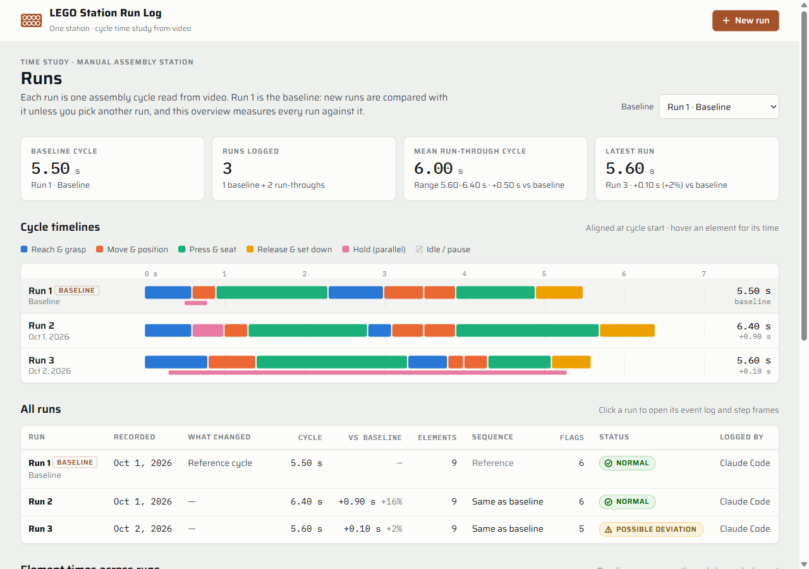

# LEGO Station Run Log

A time study of one manual assembly station, built from ordinary video. We film one LEGO
assembly cycle from above, a coding agent (Claude Code, Codex or similar) reads the video
frame by frame, and the app shows the cycle time, each work step, anything unusual, and how
the run compares with the baseline. Nobody types data in while working.

Innovation Studio 2, "The Invisible Assembly Line." The LEGO build stands in for a manual
station in the M-24 cell: white 4×6 plate, pink 1×6 brick, light-blue 2×2 slope.



## Quick start

You need **Git**, **Node.js 18 or newer** and **ffmpeg**. Check with `git --version`,
`node --version` and `ffmpeg -version`. To install what's missing:

| | Windows | Mac |
|---|---|---|
| Node.js | `winget install OpenJS.NodeJS.LTS` | `brew install node` |
| ffmpeg | `winget install Gyan.FFmpeg` | `brew install ffmpeg` |
| Git | `winget install Git.Git` | `xcode-select --install` |

Then:

```bash
git clone https://github.com/MichaelGold11/lego-station-run-log.git
cd lego-station-run-log
npm install
npm start
```

Open http://localhost:4173. `npm install` fetches two browser libraries for the live page (onnxruntime-web and MediaPipe). The main app needs nothing; the live page at http://localhost:4173/live falls back to the same pinned libraries on the jsdelivr CDN if `node_modules` is missing.

The wire line dashboard (four stations, four cameras, one laptop, one model per station) is at
http://localhost:4173/line. It records cycle and substep times, QA results and every camera's video for training.
The cameras can be USB cameras or iPhones: `npm start` also runs an HTTPS page for phones on port 4174, and each
station's **Connect a camera** button offers a QR code for its phone (needs `openssl`, which macOS and Git for Windows include).
**Team step-by-step** (run day, training your station's model, adding it, testing it):
[docs/team-guide.md](docs/team-guide.md). Technical reference: [docs/wire-line-process.md](docs/wire-line-process.md).

**Or let your agent do it.** Paste this into Claude Code or Codex:

> Clone https://github.com/MichaelGold11/lego-station-run-log, install anything its README
> says I'm missing, start the app with `npm start`, and give me the link.

## Log a run

1. **Film one cycle.** Phone straight above the table, the whole plate and all three parts in
   frame, about the same framing as Run 1. Start with the parts laid out and your hands out
   of frame; stop after the finished build is set down. Hands only, no faces.
2. **Add it.** Either way works:
   - In the app: **New run** → drop the video → name it and say what changed → **Queue for
     my agent**.
   - Or tell your agent: *"Add and analyze ~/Downloads/IMG_1234.MOV, label it 'parts
     pre-sorted'."*
3. **Analyze it.** In a terminal in this folder, ask your agent:
   - Claude Code: `/analyze-runs`
   - Codex or any other agent: *"Analyze queued runs (follow AGENTS.md)."*

   It takes a few minutes. The app updates by itself when the run is done.
4. **Share it** with the team:

   ```bash
   git pull
   git add data
   git commit -m "Run 6: parts pre-sorted"
   git push
   ```

   Run `git pull` before you add a run, so two people don't both make "Run 6".

iPhone videos in High Efficiency (HEVC) format are fine: every stored video is converted to
H.264 so it plays in any browser and stays small.

## Analyze on the shared link with your own Claude

Teammates can analyze a new run on their own time, no setup:

1. Sign in to claude.ai and open the shared link.
2. Press **New run** and drop the video.
3. Press **Analyze with your Claude**. It runs on your own claude.ai plan and asks permission
   the first time.
4. Check the event log it fills in, then save it to the shared log.

Saving the video and step frames needs Editor access on the artifact. Without it only the
timings save (the page says so). If the button is missing, the page tells you how to turn
Claude on for it.

## Compare runs

- Each run page has a **Compare with** menu. Pick any run to see both timelines, step-by-step
  time differences and the two finished builds side by side.
- The verdict (Normal / Possible deviation / Insufficient info) was written against one
  reference. To get a verdict against a different run, pick it and press **Re-check**, then
  ask your agent to analyze queued runs again. Only the comparison is redone; the timings
  stay.
- The **Baseline** menu on the Runs page sets the default reference for everyone once you push.

## How the analysis works

The full method is in [AGENTS.md](AGENTS.md), written so any agent follows it the same way:
contact sheets of frames every 0.1 s, cycle start and end, one row per work element with
what was visibly observed, flags for anything unclear or different, a frame per step, and a
comparison with the reference. `scripts/runlog.mjs` does the file and ffmpeg work and checks
every result before it is saved, so agents can't write a malformed run or a made-up timestamp.

What it will not do: identify or score the person. Runs describe the station's work, never
the operator, and contain no names or faces (the case's "no individual surveillance" rule).
Times are approximate to about ±0.1 s.

## What's in the repo

| Path | |
|---|---|
| `app/` | The web app. `lego-station-run-log.html` is the same page that runs as a claude.ai artifact. |
| `server.mjs` | Local server (`npm start`). |
| `app/live-detect.js`, `app/models/` | Live page: YOLO pre and post processing, signal mapping, build check, and the models (see `app/models/README.md`). |
| `app/line.html`, `app/line-engine.js` | Wire line dashboard (`/line`) and its config-driven engine. The process is `data/meta/wire-line.json`, which also lists one ONNX model per station under `models`. |
| `app/phone.html`, `scripts/phone-cert.mjs` | iPhone camera page (HTTPS, port 4174) and its local certificate. The certificate and pairing secret live in `data/phone-cert/` (not committed). |
| `data/sessions/` | Wire line sessions: events, CSVs and one video per station. Not committed (about 1 GB per hour). |
| `scripts/runlog.mjs` | Command-line helper: `npm run runlog -- help`. |
| `data/runs/` | One JSON file per run. |
| `data/assets/` | Videos and step frames. |
| `AGENTS.md`, `CLAUDE.md` | Instructions for coding agents. |

## Troubleshooting

- **Port 4173 is busy:** `PORT=5000 npm start` (PowerShell: `$env:PORT=5000; npm start`).
- **Port 4174 (iPhone cameras) is busy:** `PHONE_PORT=4175 npm start`, or `PHONE_PORT=off npm start` without iPhones.
- **"ffmpeg is not installed or not on PATH":** install it (table above), then open a new
  terminal.
- **The page says the local server isn't answering:** `npm start` stopped; start it again.
- **Two runs with the same number after a pull:** harmless (they have different ids). Rename
  one in its `data/runs/*.json` file if it bothers you.
